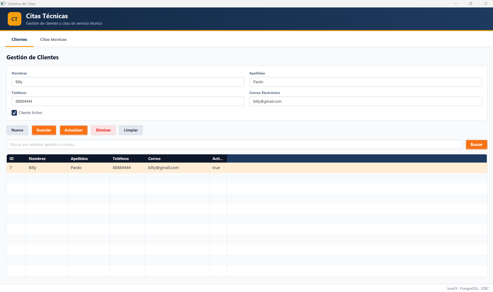
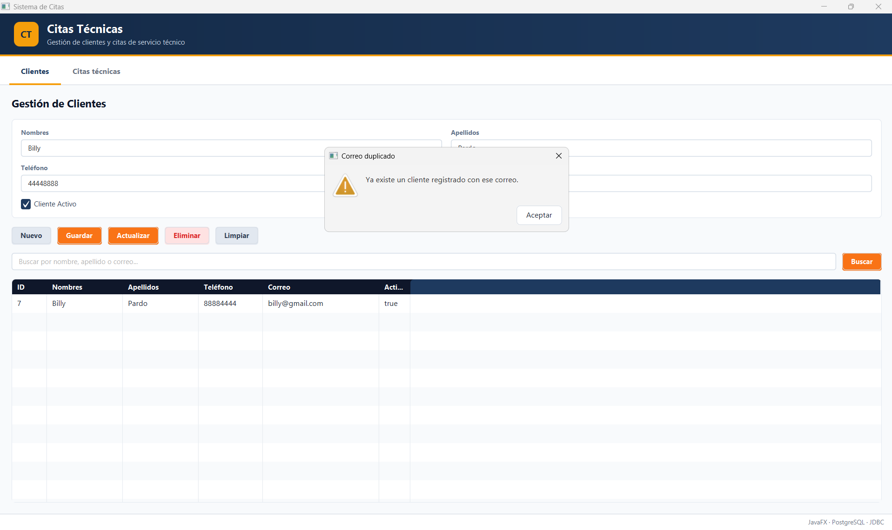
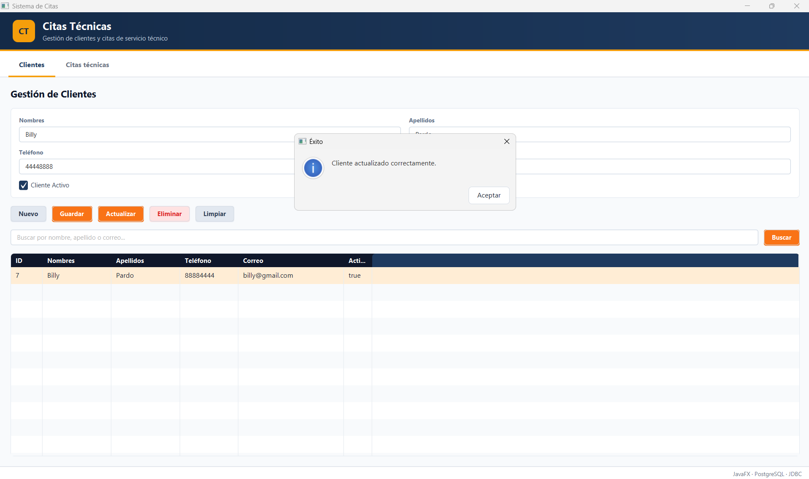
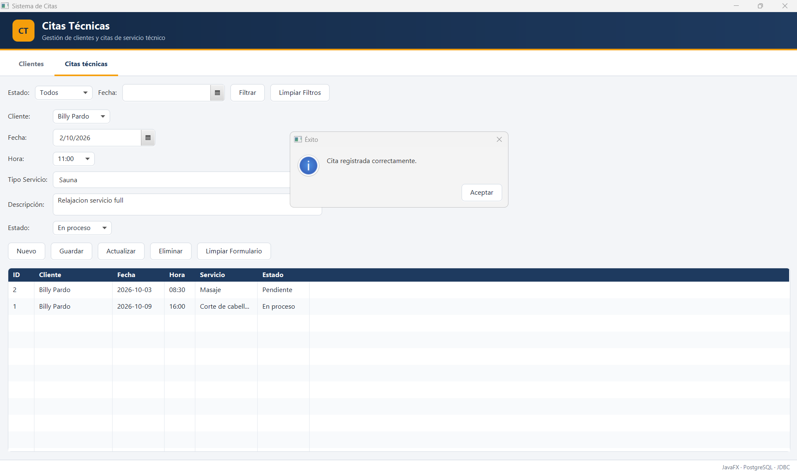
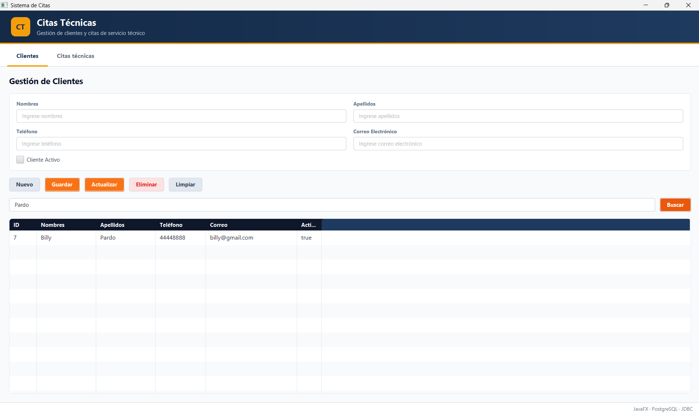
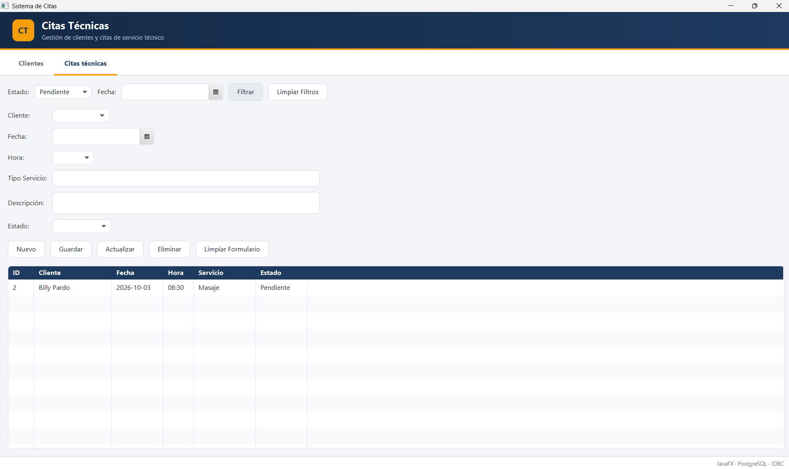
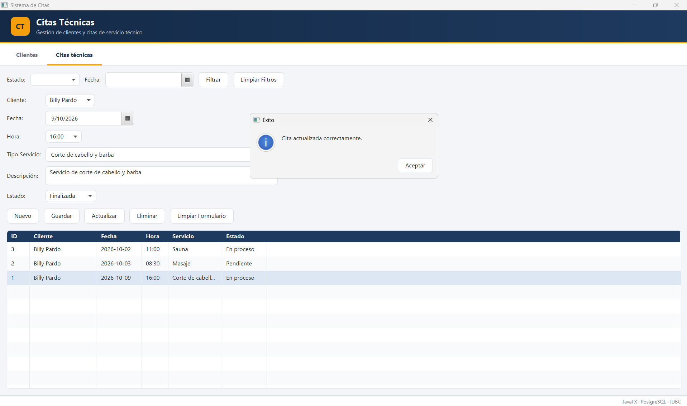
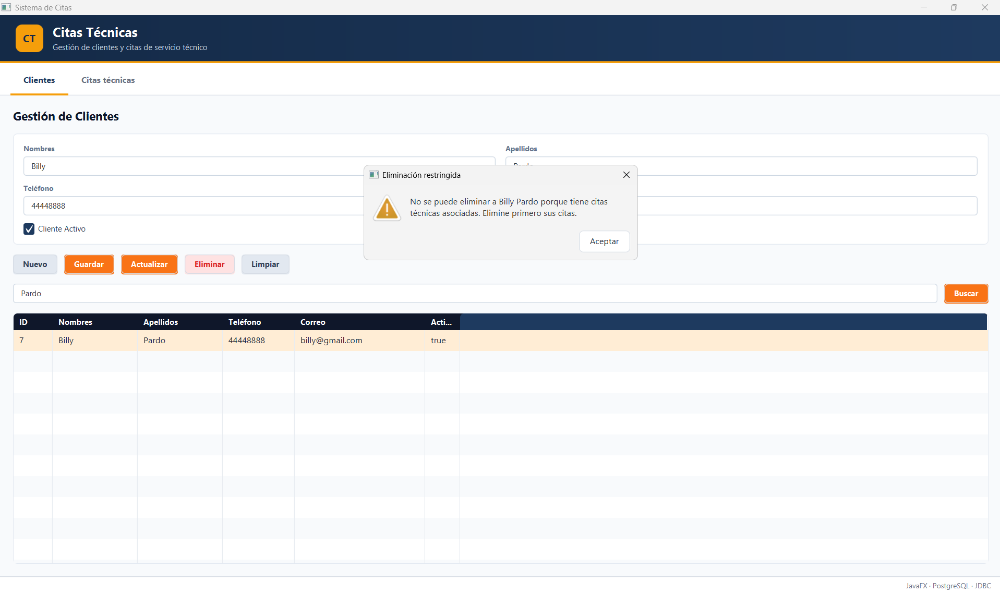

<div align="center">

# Sistema de Gestión de Citas Técnicas

### TecnoAsistencia Nicaragua S.A.

**Evaluación Práctica Sumativa · Unidad II: Acceso a bases de datos**


| | |
|---|---|
|  **Universidad** | Universidad Americana (UAM) · Ingeniería de Sistemas |
|  **Asignatura** | Programación de Aplicaciones de Escritorio |
|  **Docente** | José A. Durán García |
| **Actividad** | Módulo CRUD completo |
| **Período** | 12 al 15 de octubre de 2026 |

</div>

---

## Tabla de contenido

1. [Descripción del proyecto](#-descripción-del-proyecto)
2. [Integrantes y distribución de responsabilidades](#-integrantes-y-distribución-de-responsabilidades)
3. [Requisitos del sistema](#-requisitos-del-sistema)
4. [Instalación y configuración](#-instalación-y-configuración)
5. [Ejecución](#-ejecución)
6. [Arquitectura del proyecto](#-arquitectura-del-proyecto)
7. [Pruebas de aceptación y capturas](#-pruebas-de-aceptación-y-capturas)

---

## Descripción del proyecto

**TecnoAsistencia Nicaragua S.A.** necesita registrar a sus clientes y gestionar las citas de mantenimiento y reparación de equipos informáticos. Este proyecto es una **aplicación de escritorio desarrollada en JavaFX**, conectada a **PostgreSQL mediante JDBC puro** (sin Hibernate, JPA ni otro ORM), que permite:

- Crear, consultar, modificar y eliminar **clientes** y **citas técnicas**.
- Controlar la relación **cliente (1) → (N) cita técnica** con integridad referencial.
- Buscar clientes y filtrar citas por **estado** y **fecha**.
- ⚠Validar los datos y manejar los errores sin perder la consistencia de la información.

## Integrantes y distribución de responsabilidades

| Integrante | Usuario GitHub | Responsabilidades |
|---|---|---|
| **Diego José Silva** | [@silvadiego-08](https://github.com/silvadiego-08) | Estructura del proyecto Maven, `module-info.java`, `MainApp` y menú principal (`main-view.fxml`), clase de conexión centralizada `ConexionDB`, clase `Alertas`, modelo `CitaTecnica` y `CitaTecnicaDAO` (JOIN y filtros). Revisión e integración de los Pull Requests. |
| **Claudia Lira** | [@ClaudiaLiraB](https://github.com/ClaudiaLiraB) | Script de base de datos `gestion_citas.sql` (tablas, restricciones y datos de prueba), modelo `Cliente`, `ClienteDAO` y su clase de prueba `PruebaClienteDAO`. |
| **Mia Flores** | [@mimikfs](https://github.com/mimikfs) | Vista de clientes `cliente-view.fxml`, `ClienteController` (CRUD, búsqueda y selección en tabla) y clase de validaciones `Validador`. |
| **Celeste** | [@Celeste-10](https://github.com/Celeste-10) | Vista de citas `cita-view.fxml`, `CitaController` (CRUD de citas, ComboBox de clientes, filtros por estado y fecha) y ejecución de las pruebas de aceptación. |

---

## Requisitos del sistema

| Herramienta | Versión utilizada | Observación |
|---|---|---|
|  **JDK** | 21 | Todo el equipo debe usar la misma versión. |
|  **JavaFX** | 21.0.6 | Se descarga automáticamente con Maven. |
| **PostgreSQL** | 18 (probado) | Servidor local en el puerto `5432`. |
| **Driver JDBC** | `org.postgresql:postgresql` 42.7.13 | Incluido en el `pom.xml`. |
| **Maven** | 3.9+ (o el wrapper `mvnw` incluido) | Gestión de dependencias y compilación. |
| **IDE** | IntelliJ IDEA | Entorno usado para la defensa. |
| **Git** | Cualquier versión reciente | Control de versiones. |

---

## Instalación y configuración

### 1️⃣ Clonar el repositorio

```bash
git clone https://github.com/silvadiego-08/Evaluacion_JavaFX_CitasTecnicas.git
cd Evaluacion_JavaFX_CitasTecnicas
```

### 2️⃣ Configurar PostgreSQL localmente

1. Instalar PostgreSQL y verificar que el servicio esté **en ejecución**.
2. Abrir **pgAdmin** o la consola `psql` con el usuario `postgres`.
3. Crear la base de datos:

```sql
CREATE DATABASE gestion_citas;
```

4. Conectarse a `gestion_citas` y ejecutar el script del proyecto:

```bash
psql -U postgres -d gestion_citas -f sql/gestion_citas.sql
```

> En pgAdmin: clic derecho sobre `gestion_citas` → **Query Tool** → abrir `sql/gestion_citas.sql` → **Execute (F5)**.

El script crea las tablas `cliente` y `cita_tecnica`, sus restricciones (`UNIQUE`, `CHECK`, clave foránea) e inserta **5 clientes y 5 citas de prueba**.

### 3️⃣ Configurar las credenciales locales

> **Por seguridad, la contraseña real de la base de datos nunca se sube al repositorio.** El archivo `db.properties` está incluido en `.gitignore`.

1. Copiar la plantilla `db.properties.example` y renombrar la copia como **`db.properties`** (en la raíz del proyecto, junto al `pom.xml`).
2. Escribir los datos de su instalación local:

```properties
db.url=jdbc:postgresql://localhost:5432/gestion_citas
db.user=postgres
db.password=SU_CONTRASEÑA_LOCAL
```

| Clave | Descripción |
|---|---|
| `db.url` | Dirección JDBC del servidor y nombre de la base de datos. |
| `db.user` | Usuario de PostgreSQL. |
| `db.password` | Contraseña local del usuario (sin comillas). |

> Si falta `db.properties` o alguna de sus claves, `ConexionDB` muestra un mensaje que indica exactamente qué archivo o clave falta.

### 4️⃣ Abrir el proyecto en IntelliJ IDEA

1. **File → Open** y seleccionar la carpeta del proyecto (se reconoce como proyecto Maven).
2. **File → Project Structure → Project**: seleccionar **SDK 21** y **Language level 21**.
3. En el panel **Maven**, pulsar **Reload All Maven Projects** para descargar las dependencias.

---

## ▶️ Ejecución

**Opción A: desde IntelliJ IDEA**

- Ejecutar la clase `ni.edu.uam.citas_tecnicas.Launcher` (o `MainApp`).

**Opción B: desde la terminal con Maven**

```bash
# Windows
mvnw.cmd clean javafx:run

# Linux / macOS
./mvnw clean javafx:run
```

**Verificar la conexión antes de ejecutar (opcional)**

- Ejecutar la clase `db/PruebaConexion`, que comprueba la conexión con `SELECT 1`.

---

## Arquitectura del proyecto

El proyecto sigue una **arquitectura por capas** que separa la interfaz, la lógica de control y el acceso a datos.

```
Evaluacion_JavaFX_CitasTecnicas/
├── 📄 pom.xml                         Dependencias y plugins de Maven
├── 📄 db.properties.example           Plantilla de credenciales (sin contraseña real)
├── 📁 sql/
│   └── gestion_citas.sql              Script de tablas, restricciones y datos de prueba
└── 📁 src/main/
    ├── 📁 java/ni/edu/uam/citas_tecnicas/
    │   ├── Launcher.java              Punto de entrada
    │   ├── MainApp.java               Carga la ventana principal
    │   ├── 📁 db/                     ConexionDB (conexión centralizada) y clases de prueba
    │   ├── 📁 model/                  Cliente, CitaTecnica
    │   ├── 📁 dao/                    ClienteDAO, CitaTecnicaDAO (acceso a datos)
    │   ├── 📁 controller/             ClienteController, CitaController (controladores FXML)
    │   └── 📁 util/                   Alertas, Validador
    ├── 📄 java/module-info.java       Declaración del módulo Java
    └── 📁 resources/ni/edu/uam/citas_tecnicas/
        ├── 📁 view/                   main-view.fxml, cliente-view.fxml, cita-view.fxml
        └── 📁 css/                    styles.css
```
---

## Pruebas de aceptación y capturas

> 📸 Las capturas se encuentran en la carpeta [`docs/capturas/`](docs/capturas/).

| # | Prueba | Resultado | Evidencia |
|:---:|---|:---:|:---:|
| 1 | Registrar un cliente y comprobar su aparición en `TableView` | ✅ |  |
| 2 | Intentar registrar un correo repetido y comprobar el rechazo con un mensaje | ✅ |  |
| 3 | Modificar el teléfono del cliente y comprobar que el cambio persiste | ✅ |  |
| 4 | Registrar una cita asociada a ese cliente y mostrar su nombre en `TableView` | ✅ |  |
| 5 | Buscar por una parte del apellido y comprobar los resultados | ✅ |  |
| 6 | Filtrar citas por estado y fecha, y limpiar los filtros | ✅ |  |
| 7 | Cambiar el estado de una cita a **Finalizada** | ✅ |  |
| 8 | Intentar eliminar un cliente con citas; la operación debe rechazarse | ✅ |  |
| 9 | Eliminar la cita | ✅ |  |

---


<div align="center">

**Universidad Americana (UAM) · Managua, Nicaragua · 2026**

*Programación de Aplicaciones de Escritorio · Ingeniería de Sistemas*

</div>
